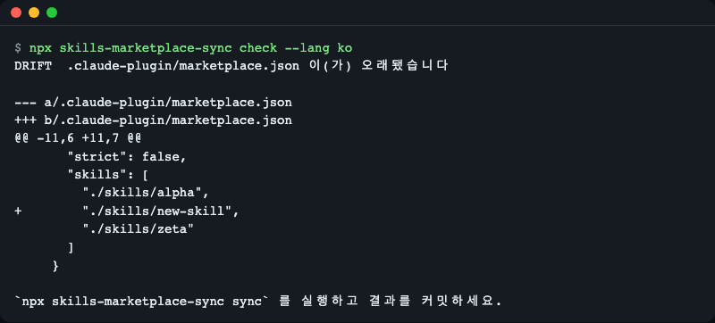
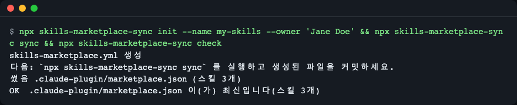
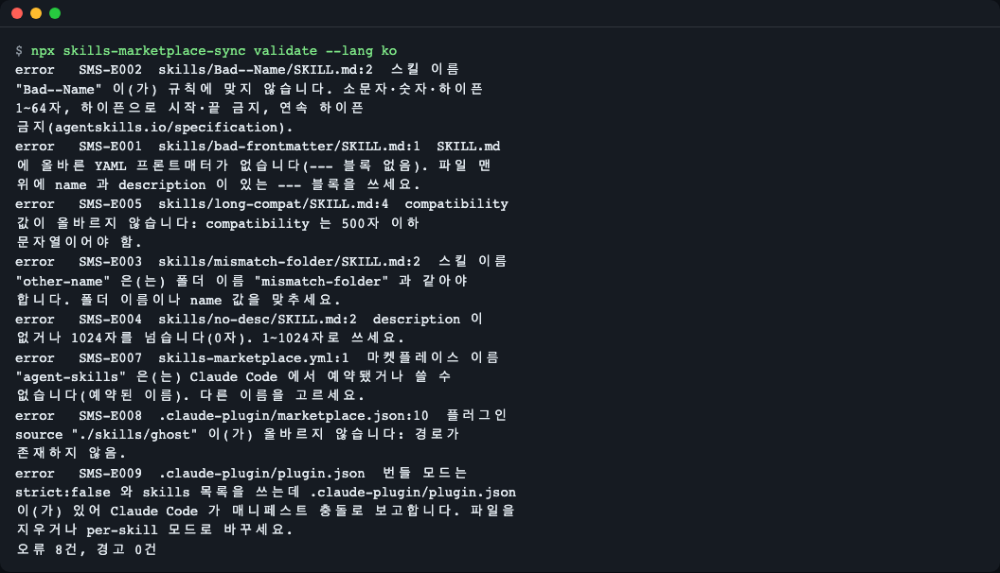
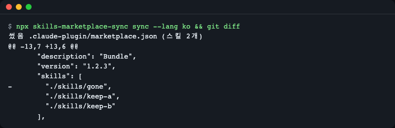

# skills-marketplace-sync

[English](README.md) | **한국어**

저장소의 `skills/*/SKILL.md` 파일에서 `.claude-plugin/marketplace.json`(선택하면 Codex 용 `.agents/plugins/marketplace.json` 도)을 생성하고, 커밋된 매니페스트가 스킬 폴더와 어긋나면 풀 리퀘스트를 실패시킵니다. 같은 코드로 만든 GitHub Action 이자 npm CLI 입니다.


*`check` 가 diff 를 보여 주고 exit 1 로 끝납니다. `skills/new-skill` 은 있는데 매니페스트에는 없기 때문입니다.*

## 무엇을 하나요

`skills/` 를 책장, `marketplace.json` 을 도서 목록이라고 생각하세요. 책이 들어올 때마다 목록을 손으로 다시 쓰고 싶은 사람도, 목록에서 책이 빠지길 바라는 사람도 없습니다. 이 도구는 책장에서 목록을 만들고, CI 는 책장과 목록이 다르면 돌려보내는 반납대 역할을 합니다.

- SKILL.md 프론트매터에서 매니페스트를 **결정적으로 생성**합니다. `sync` 를 두 번 실행해도 결과 파일이 바이트까지 같습니다.
- `claude plugin validate --strict` 가 통과시키는 Agent Skills 규칙과 마켓플레이스 규칙(잘못된 이름, 이름과 폴더 불일치, 없는 경로, 예약 이름)을 파일·줄번호와 GitHub PR 주석으로 **검사**합니다.
- **사람이 쓴 내용은 보존**합니다. 직접 넣은 키(`version`, `keywords`, `homepage`, `$schema`)와 도구가 관리하지 않는 항목(예: 외부 GitHub 플러그인)은 재생성해도 남습니다.
- **두 에이전트에서 동작**합니다. 기본인 bundle 매니페스트는 Claude Code 와 Codex 가 모두 읽는 파일 하나입니다.

목(mock) 모드는 없습니다. 로컬 파일만 읽고 쓰므로 API 키도 네트워크도 필요 없습니다(Action 은 의존성 `yaml` 하나를 위해 `npm ci` 를 한 번 실행합니다).

## 요구 사항

| 호스트 / 도구 | 확인한 버전 | 비고 |
|---|---|---|
| Node.js | 로컬 v26.13.0, CI 는 26, 20.20.2 에서도 확인 | `engines.node >=20` |
| GitHub Actions 러너 | `ubuntu-latest` | Action 용. CLI 는 Node 가 있는 곳이면 어디서나 |
| Claude Code | 2.1.322 | 선택: `claude` 가 `PATH` 에 있으면 우리 검사 뒤에 `claude plugin validate --strict` 도 실행 |
| codex-cli | 0.154.0 | 선택: `npm run e2e:agents` 에서만 사용 |

런타임 의존성은 `yaml` 2.9.1 하나입니다. 빌드 도구는 `typescript` 7.0.2, `@types/node` 26.6.6 입니다. Node 는 패키지 관리자로 설치하세요(예: macOS `brew install node`, Debian/Ubuntu `apt-get install nodejs npm`).

## 설치

아직 npm 레지스트리에 게시되지 않았습니다. 그때까지는 GitHub 에서 설치합니다.

```bash
git clone https://github.com/LeeGyeongPil/skills-marketplace-sync.git
cd skills-marketplace-sync
npm ci
npm run build
node dist/cli.js --help
```

게시 전에 clone 을 다른 저장소에 쓰려면 `node path/to/skills-marketplace-sync/dist/cli.js sync --cwd <your-repo>` 를 실행하세요. 게시된 뒤에는 어느 저장소에서나 `npx skills-marketplace-sync <명령>` 으로 쓸 수 있습니다. 이 문서는 명령을 그 형태로 적습니다. Action 에서는 `uses: LeeGyeongPil/skills-marketplace-sync@v0.1.0` 을 씁니다.

## 빠르게 시작하기

`skills/<이름>/SKILL.md` 폴더가 있는 저장소에서:

```bash
npx skills-marketplace-sync init --name my-skills --owner "Jane Doe"
npx skills-marketplace-sync sync
npx skills-marketplace-sync check
```


*`init` 이 `skills-marketplace.yml` 을, `sync` 가 매니페스트를 쓰고, `check` 가 둘이 일치하는지 확인합니다(스크린샷은 `--claude-validate false` 로 찍어 `claude` 줄이 없습니다).*

세 명령의 실제 출력(데모 스킬 3개, `--lang en` 기준). `claude plugin validate --strict: passed` 줄은 `claude` 가 `PATH` 에 있을 때만(`--claude-validate auto`) 나타나고, 없으면 건너뜁니다:

```text
created skills-marketplace.yml
Next: run `npx skills-marketplace-sync sync`, then commit the generated files.
wrote .claude-plugin/marketplace.json (3 skills)
claude plugin validate --strict: passed
OK  .claude-plugin/marketplace.json is up to date (3 skills)
claude plugin validate --strict: passed
```

생성된 파일:

```json
{
  "name": "my-skills",
  "owner": {
    "name": "Jane Doe"
  },
  "description": "Agent skills from my-skills",
  "plugins": [
    {
      "name": "my-skills",
      "source": "./",
      "strict": false,
      "skills": [
        "./skills/commit-helper",
        "./skills/pdf-tools",
        "./skills/release-notes"
      ]
    }
  ]
}
```

커밋하면 사용자는 같은 저장소에서 설치할 수 있습니다.

```bash
claude plugin marketplace add owner/repo
codex plugin marketplace add owner/repo
```

## CI 에서 쓰기

```yaml
# .github/workflows/skills.yml
name: skills
on: [pull_request]
jobs:
  manifest:
    runs-on: ubuntu-latest
    steps:
      - uses: actions/checkout@v4
      - uses: LeeGyeongPil/skills-marketplace-sync@v0.1.0
        with:
          command: check
```

| 입력 | 기본값 | 뜻 |
|---|---|---|
| `command` | `check` | `check`(drift 면 실패), `sync`(파일 쓰기), `validate`(규칙 검사만) |
| `config` | `skills-marketplace.yml` | 설정 파일, `working-directory` 기준 |
| `working-directory` | `.` | `skills/` 가 있는 저장소 루트 |
| `lang` | 환경에서 결정 | `en` 또는 `ko` |
| `claude-validate` | `auto` | `claude plugin validate --strict` 도 실행: `auto`, `true`, `false` |

출력은 `drift`(`true`/`false`)와 `errors`(규칙 오류 개수)입니다.

`GITHUB_ACTIONS=true` 이면 각 진단이 워크플로 명령으로도 출력되어 풀 리퀘스트의 해당 줄에 주석으로 나타납니다.

`validate` 를 잘못된 테스트 픽스처에 실행한 실제 출력입니다(`GITHUB_ACTIONS=true`, 앞 세 줄). 각 줄이 PR 의 인라인 주석이 됩니다.

```text
::error file=skills/Bad--Name/SKILL.md,line=2,title=SMS-E002::스킬 이름 "Bad--Name" 이(가) 규칙에 맞지 않습니다. 소문자·숫자·하이픈 1~64자, 하이픈으로 시작·끝 금지, 연속 하이픈 금지(agentskills.io/specification).
::error file=skills/bad-frontmatter/SKILL.md,line=1,title=SMS-E001::SKILL.md 에 올바른 YAML 프론트매터가 없습니다(--- 블록 없음). 파일 맨 위에 name 과 description 이 있는 --- 블록을 쓰세요.
::error file=skills/long-compat/SKILL.md,line=4,title=SMS-E005::compatibility 값이 올바르지 않습니다: compatibility 는 500자 이하 문자열이어야 함.
```
*각 줄이 PR 인라인 주석이 됩니다: `::error file=...,line=...,title=SMS-E002::메시지`.*

## 사용법

### drift 검사

`check` 는 매니페스트를 메모리에서 다시 만들어 커밋된 파일과 바이트 단위로 비교하고, 다르면 unified diff 와 함께 exit 1 로 끝납니다(첫 이미지 참고). `sync` 로 고치고 커밋하세요.

### 공식 검사기가 보지 않는 규칙

`Bad--Name` 이라는 스킬이 있는 테스트 저장소에서 공식 검사기와 이 도구의 결과가 갈립니다.

```text
$ claude plugin validate <repo> --strict
Validating marketplace manifest: <repo>/.claude-plugin/marketplace.json

✔ Validation passed
$ npx skills-marketplace-sync validate --lang en
error   SMS-E002  skills/Bad--Name/SKILL.md:2  Skill name "Bad--Name" is invalid. Use 1-64 chars of a-z, 0-9 a...
1 error(s), 0 warning(s)
```


*`test/fixtures/invalid` 픽스처의 모든 규칙 위반이 파일·줄번호와 함께 나옵니다.*

| 코드 | 수준 | 내용 |
|---|---|---|
| SMS-E001 | error | SKILL.md 에 프론트매터가 없거나 YAML 파싱 실패 |
| SMS-E002 | error | `name` 이 Agent Skills 형식 위반(1~64자, `a-z0-9-`, 시작·끝·연속 하이픈 금지) |
| SMS-E003 | error | `name` 이 부모 폴더 이름과 다름 |
| SMS-E004 | error | `description` 이 없거나 1024자 초과 |
| SMS-E005 | error | `compatibility` 가 500자 초과이거나 `metadata` 가 문자열 맵이 아님 |
| SMS-E006 | error | 플러그인 이름 중복(보존 항목 포함) |
| SMS-E007 | error | 예약된 마켓플레이스 이름 |
| SMS-E008 | error | 상대 `source` 가 `./` 로 시작하지 않거나 `..` 를 포함하거나 경로가 없음 |
| SMS-E009 | error | bundle 이 `strict: false` 인데 루트 `.claude-plugin/plugin.json` 이 있음(매니페스트 충돌) |
| SMS-E010 | error | Codex 이름 규칙 또는 policy 값 위반 |
| SMS-W001 | warning | per-skill 모드인데 `codex` 대상이 없음: Codex 는 그 항목들을 스킬로 로드하지 않음 |
| SMS-W002 | warning | 항목과 `plugin.json` 양쪽에 `version` 선언 |
| SMS-W003 | warning | 항목에 `engines` 가 있음 |
| SMS-W004 | warning | `codex` 대상과 `exclude` 동시 사용: Codex 번들은 `skills/` 전체를 로드 |
| SMS-W005 | warning | 마켓플레이스 description 없음 |
| SMS-W006 | warning | 플러그인 이름이 `claude-` 또는 `anthropic-` 로 시작 |

규칙을 어긴 스킬은 생성된 매니페스트에서 빠지고, 파일은 그래도 쓰이며, 종료 코드는 1 입니다.

### 직접 쓴 내용은 보존됩니다

`sync` 는 자기가 관리하는 키만 덮어씁니다. 사람이 `version`, `keywords`, `homepage`, `$schema` 줄, 외부 GitHub 플러그인 항목을 넣어 둔 매니페스트에서 스킬 폴더를 지우면 `skills` 목록만 바뀝니다.


*`sync` 뒤의 diff: `./skills/gone` 만 빠지고 손으로 쓴 내용은 그대로입니다.*

- 관리 키: 최상위 `name`, `owner`, `description`(설정에 있을 때). bundle 항목의 `name`, `source`, `strict`, `skills`. per-skill 항목은 `description` 도. Codex 파일은 `name`, `interface.displayName`, 항목 `name`, `source`, `policy`, `category`.
- 그 밖의 키(`version`, `keywords`, `homepage`, `author`, `$schema`, `renames`, 모르는 키)는 값을 그대로 둡니다. 첫 `sync` 에서 관리하는 항목의 키 순서가 표준 순서로 정리될 수 있습니다(예: `skills` 뒤에 둔 `version`). 값은 바뀌지 않습니다.
- 도구가 관리하지 않는 항목(원격 소스, 다른 폴더)은 그 자리에서 손대지 않습니다.

### bundle 과 per-skill

| 모드 | 매니페스트 모양 | Claude Code | Codex |
|---|---|---|---|
| `bundle`(기본) | 플러그인 하나, `source: "./"`, `strict: false`, `skills: [...]` | 스킬 전체가 든 플러그인 하나 설치 | 같은 파일을 읽고 `skills` 부분집합을 존중 |
| `per-skill` | 스킬마다 플러그인 항목 하나 | 스킬별로 따로 설치 | 스킬로 로드하지 않음. `targets: [claude, codex]` 를 쓰면 `.agents/plugins/marketplace.json` 에 번들 항목 하나를 씀 |

### Codex 대상

`targets: [claude, codex]` 이면 `.agents/plugins/marketplace.json` 도 씁니다.

```json
{
  "name": "demo-skills",
  "interface": {
    "displayName": "Demo skills"
  },
  "plugins": [
    {
      "name": "demo-skills",
      "source": {
        "source": "local",
        "path": "./"
      },
      "policy": {
        "installation": "AVAILABLE",
        "authentication": "ON_INSTALL"
      },
      "category": "Productivity"
    }
  ]
}
```

`policy.installation` 허용값: `AVAILABLE`, `INSTALLED_BY_DEFAULT`, `NOT_AVAILABLE`. `policy.authentication` 허용값: `ON_INSTALL`, `ON_FIRST_USE`.

## 설정

`skills-marketplace.yml`:

```yaml
name: my-skills              # 마켓플레이스 이름 (필수)
owner: { name: Jane Doe }    # 필수 (email·url 은 선택)
description: Skills for ...  # 선택, 없으면 SMS-W005
mode: bundle                 # bundle(기본) | per-skill
targets: [claude]            # claude(기본), .agents/plugins 를 쓰려면 codex 추가
skillsDir: skills            # 기본 skills
exclude: []                  # 폴더 glob, 예: draft-*
plugin:                      # bundle 항목
  name: my-skills            # 기본은 마켓플레이스 이름
  description: All skills
codex:                       # targets 에 codex 가 있을 때 사용
  displayName: My skills
  category: Productivity
  policy: { installation: AVAILABLE, authentication: ON_INSTALL }
```

키를 잘못 쓰면 오류 없이 무시됩니다. `targets` 에 `codex` 가 있으면 `skillsDir: skills` 여야 합니다.

## CLI 레퍼런스

```text
skills-marketplace-sync <init|sync|check|validate> [options]
  --cwd <dir>                          repository root (default .)
  --config <file>                      config file (default skills-marketplace.yml)
  --format text|json                   output format (default text)
  --claude-validate auto|true|false    also run `claude plugin validate --strict` (default auto)
  --lang en|ko                         message language
  init only: --name <name> --owner <name> [--mode bundle|per-skill] [--targets claude,codex]
```

종료 코드: `0` 정상, `1` 규칙 오류 또는 drift, `2` 사용법·설정 오류.

언어 결정 순서: `--lang` > `SKILLS_MARKETPLACE_SYNC_LANG` > `LC_ALL` > `LC_MESSAGES` > `LANG`. 한국어가 아니면 영어입니다. 예: `npx skills-marketplace-sync check --lang ko` 는 한국어 메시지를 냅니다(이 문서의 스크린샷이 한국어 화면입니다).

## 실제 에이전트로 확인하기

```bash
npm run e2e:agents
```

데모 저장소를 임시 폴더에 복사해 `sync` 를 실행하고, 실제 `claude plugin validate --strict` 로 검사하며, 격리한 `CODEX_HOME` 에 마켓플레이스를 설치해 Codex 가 로드하는 스킬 수를 셉니다. CLI 가 없으면 그 줄은 `SKIP` 으로 나옵니다. 실제 출력(2026-11-24):

```text
claude: Validation passed (2.1.322 (Claude Code))
codex: 3 skills loaded (codex-cli 0.154.0)
```

## 한계

- `mode` 를 `bundle` 에서 `per-skill` 로(또는 반대로) 바꾸면 이전 bundle 항목이 파일에 남습니다. 더는 관리 항목이 아니라서 보존되기 때문이니 손으로 지우세요.
- 실제 Claude Code 프로필에 설치하는 자동 테스트는 없습니다. 공식 검사기와 문서화된 규칙으로 대신합니다.
- Codex 에는 validate 명령이 없어 Codex 쪽은 스킬 로드 여부만 확인합니다.
- per-skill 모드는 아직 Codex 용 래퍼 폴더를 만들지 않습니다. Codex 에는 번들 항목 하나가 갑니다.
- 디렉터리를 가리키는 심볼릭 링크 스킬 폴더는 따라가 포함하고, 끊어진 링크는 건너뜁니다.
- 도구가 커밋하거나 PR 을 열지는 않습니다. `sync` 를 직접 실행해 커밋하세요.
- 규칙과 예약 이름 목록은 2026-11-24 기준 Claude Code 문서를 따르며 바뀔 수 있습니다.

## 언제 쓰나

- 잘 맞는 경우: 스킬 폴더가 많아 매니페스트가 자꾸 낡고, 그럴 때 PR 이 실패하길 원할 때.
- 플러그인을 손으로 쓰거나 검증하려면 [Claude Code 플러그인 문서](https://code.claude.com/docs/en/plugins)와 `claude plugin validate` 명령을 보세요.
- Codex 플러그인 세부 사항은 [Codex 문서](https://developers.openai.com/codex)를 보세요.

## 자주 겪는 문제

| 증상 | 원인 | 해결 |
|---|---|---|
| `check` 가 `DRIFT` 와 함께 exit 1 | 스킬을 추가·이름 변경·삭제하고 재생성하지 않음 | `npx skills-marketplace-sync sync` 실행 후 커밋 |
| `SMS-E003` | 폴더 이름과 `name:` 이 다름 | 둘을 같게 맞춤 |
| `SMS-E009` | 루트 `.claude-plugin/plugin.json` 이 bundle 과 충돌 | 삭제하거나 `mode: per-skill` 사용 |
| 종료 코드 2 | 설정 없음, 알 수 없는 옵션, 여분 인자(경로는 `--cwd` 로), 쓸 수 없는 파일, YAML 오류 | `init` 을 실행하거나 메시지가 알려 준 YAML 을 고침(알 수 없는 옵션은 `--help` 를 안내하는 메시지가 나옴) |
| 매니페스트가 CRLF 줄바꿈으로 체크아웃됨(Windows, `core.autocrlf`) | `check` 는 CRLF 를 무시하므로 `DRIFT` 는 실제 내용 차이 | `sync` 후 커밋. 생성 파일을 LF 로 유지하려면 `.gitattributes` 에 `*.json text eol=lf` 추가 |
| Action 이 `npm ci` 에서 실패 | 러너가 레지스트리에 접근하지 못함 | 레지스트리를 허용하거나 체크아웃에서 CLI 를 직접 실행 |

## 개발

```bash
npm ci
npm test        # 빌드 후 node --test 실행 (오프라인)
npm start       # examples/demo-skills 검사
```

Action 이 실행하므로 `dist/` 는 커밋되어 있고, 릴리스 전에 `npm run verify:dist`(빌드 후 `git diff --exit-code dist/`)로 확인합니다. 변경 기록은 [CHANGELOG.md](CHANGELOG.md).

## 라이선스

MIT.
