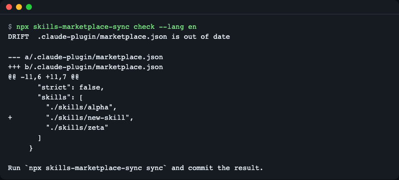
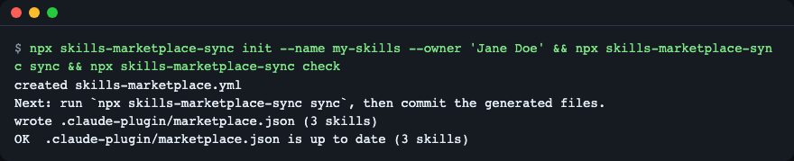
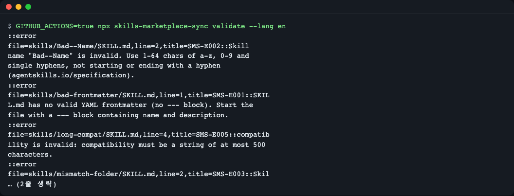
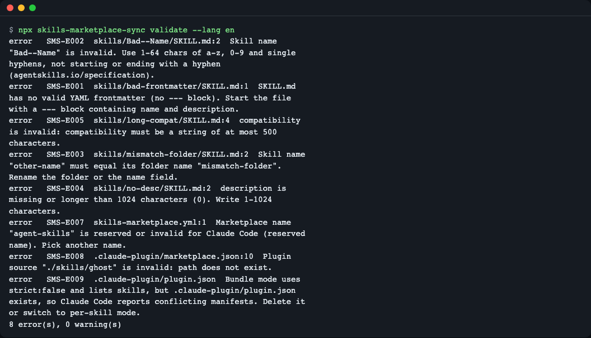
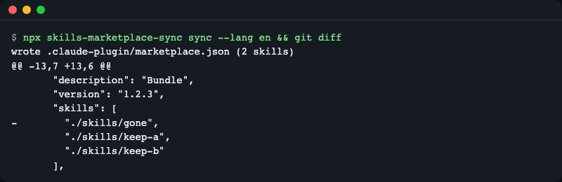

# skills-marketplace-sync

**English** | [한국어](README.ko.md)

Generate `.claude-plugin/marketplace.json` (and, optionally, Codex's `.agents/plugins/marketplace.json`) from the `skills/*/SKILL.md` files in your repository, and fail the pull request when the committed manifest no longer matches the skill folders. It is a GitHub Action and an npm CLI built from the same code.


*`check` prints a diff and exits 1: `skills/new-skill` exists, but the manifest does not list it.*

## What it does

Think of `skills/` as a bookshelf and `marketplace.json` as the catalog card list. Nobody wants to retype the list every time a book arrives, and nobody wants a book missing from it. This tool writes the list from the shelf, and the CI job is the return desk that refuses a shelf and a list that disagree.

- **Generates** the manifest deterministically from SKILL.md frontmatter. Running `sync` twice gives byte-identical files.
- **Checks** the Agent Skills rules and marketplace rules that `claude plugin validate --strict` lets through (invalid names, name and folder mismatch, missing paths, reserved names), with file and line numbers and GitHub PR annotations.
- **Keeps your edits**: hand-written keys (`version`, `keywords`, `homepage`, `$schema`) and entries it does not manage (for example an external GitHub plugin) are preserved on regeneration.
- **Works for both agents**: the default bundle manifest is one file that Claude Code and Codex both load.

There is no mock mode: the tool only reads and writes local files, so nothing needs an API key or network access (the Action runs `npm ci` once for its single dependency, `yaml`).

## Requirements

| Host / tool | Version checked | Notes |
|---|---|---|
| Node.js | v26.13.0 locally; CI runs 20 and lts | `engines.node >=20` |
| GitHub Actions runner | `ubuntu-latest` | for the Action; the CLI works anywhere Node runs |
| Claude Code | 2.1.322 | optional: `claude plugin validate --strict` runs after our checks when `claude` is on `PATH` |
| codex-cli | 0.154.0 | optional: only used by `npm run e2e:agents` |

Runtime dependency: `yaml` 2.9.1. Build tools: `typescript` 7.0.2, `@types/node` 26.6.6. Install Node with your package manager, for example `brew install node` (macOS) or `apt-get install nodejs npm` (Debian/Ubuntu).

## Install

The package is not published to the npm registry yet. Until then, install from GitHub:

```bash
git clone https://github.com/LeeGyeongPil/skills-marketplace-sync.git
cd skills-marketplace-sync
npm ci
npm run build
node dist/cli.js --help
```

Once published, `npx skills-marketplace-sync <command>` will work from any repository; this README writes commands in that form. In the Action, use `uses: LeeGyeongPil/skills-marketplace-sync@v0.1.0`.

## Quick start

In a repository that has `skills/<name>/SKILL.md` folders:

```bash
npx skills-marketplace-sync init --name my-skills --owner "Jane Doe"
npx skills-marketplace-sync sync
npx skills-marketplace-sync check
```


*`init` writes `skills-marketplace.yml`, `sync` writes the manifest, `check` confirms they agree (screenshot taken with `--claude-validate false`, so the `claude` lines are absent).*

Real output of those three commands (three demo skills). The `claude plugin validate --strict: passed` lines appear only when `claude` is on your `PATH` (`--claude-validate auto`); without it they are skipped:

```text
created skills-marketplace.yml
Next: run `npx skills-marketplace-sync sync`, then commit the generated files.
wrote .claude-plugin/marketplace.json (3 skills)
claude plugin validate --strict: passed
OK  .claude-plugin/marketplace.json is up to date (3 skills)
claude plugin validate --strict: passed
```

The generated file:

```json
{
  "name": "my-skills",
  "owner": {
    "name": "Jane Doe"
  },
  "description": "Agent skills from my-skills",
  "plugins": [
    {
      "name": "my-skills",
      "source": "./",
      "strict": false,
      "skills": [
        "./skills/commit-helper",
        "./skills/pdf-tools",
        "./skills/release-notes"
      ]
    }
  ]
}
```

Commit it. Users can then install from the same repository:

```bash
claude plugin marketplace add owner/repo
codex plugin marketplace add owner/repo
```

## Use in CI

```yaml
# .github/workflows/skills.yml
name: skills
on: [pull_request]
jobs:
  manifest:
    runs-on: ubuntu-latest
    steps:
      - uses: actions/checkout@v4
      - uses: LeeGyeongPil/skills-marketplace-sync@v0.1.0
        with:
          command: check
```

| Input | Default | Meaning |
|---|---|---|
| `command` | `check` | `check` (fails on drift), `sync` (writes files) or `validate` (rules only) |
| `config` | `skills-marketplace.yml` | config file, relative to `working-directory` |
| `working-directory` | `.` | repository root that holds `skills/` |
| `lang` | from environment | `en` or `ko` |
| `claude-validate` | `auto` | also run `claude plugin validate --strict`: `auto`, `true`, `false` |

Outputs: `drift` (`true` or `false`) and `errors` (number of rule errors).

When `GITHUB_ACTIONS=true`, each finding is also printed as a workflow command, so it appears on the changed line of the pull request:


*Each line becomes an inline PR annotation: `::error file=...,line=...,title=SMS-E002::message`.*

## Usage

### Drift check

`check` regenerates the manifests in memory, compares them byte for byte with the committed files, and exits 1 with a unified diff when they differ (see the first image). Fix it with `sync` and commit.

### Rules the official validator does not check

In a test repository with a skill named `Bad--Name`, the official validator and this tool disagree:

```text
$ claude plugin validate <repo> --strict
Validating marketplace manifest: <repo>/.claude-plugin/marketplace.json

✔ Validation passed
$ npx skills-marketplace-sync validate --lang en
error   SMS-E002  skills/Bad--Name/SKILL.md:2  Skill name "Bad--Name" is invalid. Use 1-64 chars of a-z, 0-9 a...
1 error(s), 0 warning(s)
```


*All rule violations in the `test/fixtures/invalid` fixture, each with file and line.*

| Code | Level | Meaning |
|---|---|---|
| SMS-E001 | error | SKILL.md has no frontmatter or the YAML does not parse |
| SMS-E002 | error | `name` breaks the Agent Skills format (1-64 chars, `a-z0-9-`, no leading, trailing or double hyphen) |
| SMS-E003 | error | `name` differs from the parent folder name |
| SMS-E004 | error | `description` missing or longer than 1024 characters |
| SMS-E005 | error | `compatibility` longer than 500 characters, or `metadata` is not a string map |
| SMS-E006 | error | duplicate plugin name (including preserved entries) |
| SMS-E007 | error | reserved marketplace name |
| SMS-E008 | error | relative `source` does not start with `./`, contains `..`, or the path does not exist |
| SMS-E009 | error | bundle uses `strict: false` but a root `.claude-plugin/plugin.json` exists (conflicting manifests) |
| SMS-E010 | error | Codex name rule or policy value violated |
| SMS-W001 | warning | per-skill mode without the `codex` target: Codex does not load those entries as skills |
| SMS-W002 | warning | `version` declared in both the entry and `plugin.json` |
| SMS-W003 | warning | entry contains `engines` |
| SMS-W004 | warning | `codex` target with `exclude`: the Codex bundle loads all of `skills/` |
| SMS-W005 | warning | marketplace description missing |
| SMS-W006 | warning | plugin name starts with `claude-` or `anthropic-` |

Skills that violate a rule are left out of the generated manifest, the file is still written, and the exit code is 1.

### Your edits are kept

`sync` overwrites only the keys it manages. In a manifest where a person added `version`, `keywords`, `homepage`, a `$schema` line and an external GitHub plugin entry, removing a skill folder changes only the `skills` list:


*The diff after `sync`: `./skills/gone` is dropped, everything hand-written stays.*

- Managed keys: top-level `name`, `owner`, `description` (when set in the config); in the bundle entry `name`, `source`, `strict`, `skills`; in per-skill entries also `description`. Codex file: `name`, `interface.displayName`, entry `name`, `source`, `policy`, `category`.
- Everything else (`version`, `keywords`, `homepage`, `author`, `$schema`, `renames`, unknown keys) keeps its value.
- Entries the tool does not manage (remote sources, other folders) stay untouched, in place.

### Bundle vs per-skill

| Mode | Manifest shape | Claude Code | Codex |
|---|---|---|---|
| `bundle` (default) | one plugin, `source: "./"`, `strict: false`, `skills: [...]` | installs one plugin with all skills | loads the same file and honors the `skills` subset |
| `per-skill` | one plugin entry per skill | each skill installs separately | does not load them as skills; add `targets: [claude, codex]`, which writes a single bundle entry in `.agents/plugins/marketplace.json` |

### Codex target

With `targets: [claude, codex]` the tool also writes `.agents/plugins/marketplace.json`:

```json
{
  "name": "demo-skills",
  "interface": {
    "displayName": "Demo skills"
  },
  "plugins": [
    {
      "name": "demo-skills",
      "source": {
        "source": "local",
        "path": "./"
      },
      "policy": {
        "installation": "AVAILABLE",
        "authentication": "ON_INSTALL"
      },
      "category": "Productivity"
    }
  ]
}
```

Allowed `policy.installation`: `AVAILABLE`, `INSTALLED_BY_DEFAULT`, `NOT_AVAILABLE`. Allowed `policy.authentication`: `ON_INSTALL`, `ON_FIRST_USE`.

## Configuration

`skills-marketplace.yml`:

```yaml
name: my-skills              # marketplace name (required)
owner: { name: Jane Doe }    # required (email and url optional)
description: Skills for ...  # optional, SMS-W005 if missing
mode: bundle                 # bundle (default) | per-skill
targets: [claude]            # claude (default); add codex for .agents/plugins
skillsDir: skills            # default: skills
exclude: []                  # folder globs, for example draft-*
plugin:                      # bundle entry
  name: my-skills            # default: the marketplace name
  description: All skills
codex:                       # used when targets include codex
  displayName: My skills
  category: Productivity
  policy: { installation: AVAILABLE, authentication: ON_INSTALL }
```

A misspelled key is ignored, not reported. `targets` with `codex` requires `skillsDir: skills`.

## CLI reference

```text
skills-marketplace-sync <init|sync|check|validate> [options]
  --cwd <dir>                          repository root (default .)
  --config <file>                      config file (default skills-marketplace.yml)
  --format text|json                   output format (default text)
  --claude-validate auto|true|false    also run `claude plugin validate --strict` (default auto)
  --lang en|ko                         message language
  init only: --name <name> --owner <name> [--mode bundle|per-skill] [--targets claude,codex]
```

Exit codes: `0` ok, `1` rule error or drift, `2` usage or config error.

Language order: `--lang` > `SKILLS_MARKETPLACE_SYNC_LANG` > `LC_ALL` > `LC_MESSAGES` > `LANG`; anything that is not Korean falls back to English. For example `npx skills-marketplace-sync check --lang ko` prints Korean messages (the Korean screenshots are in [README.ko.md](README.ko.md)).

## Verify with real agents

```bash
npm run e2e:agents
```

It copies the demo repository to a temporary folder, runs `sync`, asks the real `claude plugin validate --strict`, and installs the marketplace into an isolated `CODEX_HOME` to count the skills Codex loads. A missing CLI prints `SKIP` for that line. Real output (2026-11-24):

```text
claude: Validation passed (2.1.322 (Claude Code))
codex: 3 skills loaded (codex-cli 0.154.0)
```

## Limitations

- Switching `mode` from `bundle` to `per-skill` (or back) leaves the previous bundle entry in the file: it is no longer a managed entry, so it is preserved. Delete it by hand.
- There is no automated test that installs into a real Claude Code profile; the official validator and the documented rules stand in for it.
- Codex has no validate command, so the Codex side is checked by loading the skills only.
- Per-skill mode does not generate Codex wrapper folders yet; Codex gets one bundle entry.
- Skill folders that are symlinks to a directory are followed; broken links are skipped.
- The tool does not commit or open pull requests; run `sync` yourself and commit.
- Rules and the reserved-name list follow the Claude Code documentation as of 2026-11-24 and can change.

## When to use it

- Good fit: a repository of many skill folders where the manifest keeps going stale, and you want PRs to fail when it does.
- For writing a plugin by hand or validating one, see the [Claude Code plugin docs](https://code.claude.com/docs/en/plugins) and its `claude plugin validate` command.
- For Codex plugin details, see the [Codex documentation](https://developers.openai.com/codex).

## Troubleshooting

| Symptom | Cause | Fix |
|---|---|---|
| `check` exits 1 with `DRIFT` | a skill was added, renamed or removed without regenerating | run `npx skills-marketplace-sync sync` and commit |
| `SMS-E003` | folder name and `name:` differ | rename one so they are equal |
| `SMS-E009` | root `.claude-plugin/plugin.json` conflicts with a bundle | delete it or use `mode: per-skill` |
| Exit code 2 | missing config, unknown option or YAML error | run `init`, or fix the YAML shown in the message (an unknown option prints `Unknown option ... See --help`) |
| Manifest checked out with CRLF line endings (Windows, `core.autocrlf`) | `check` ignores CRLF, so a `DRIFT` is a real content difference | run `sync` and commit; to keep generated files LF, add `*.json text eol=lf` to `.gitattributes` |
| Action fails at `npm ci` | runner has no network access to the registry | allow the registry or run the CLI from a checkout |

## Development

```bash
npm ci
npm test        # builds, then runs node --test (22 tests, offline)
npm start       # checks examples/demo-skills
```

`dist/` is committed because the Action runs it; CI fails if it is stale (`npm run build && git diff --exit-code dist/`). Changes are listed in [CHANGELOG.md](CHANGELOG.md).

## License

MIT.
